# Implemented-screen previews

Browser captures use the same React Native presentation code at the EMA frame size, 402 × 874. They are web review previews, not native simulator captures. Action colors are blue by the user's explicit decision; source artwork remains purple where present. Demo content and larger controls are intentional.

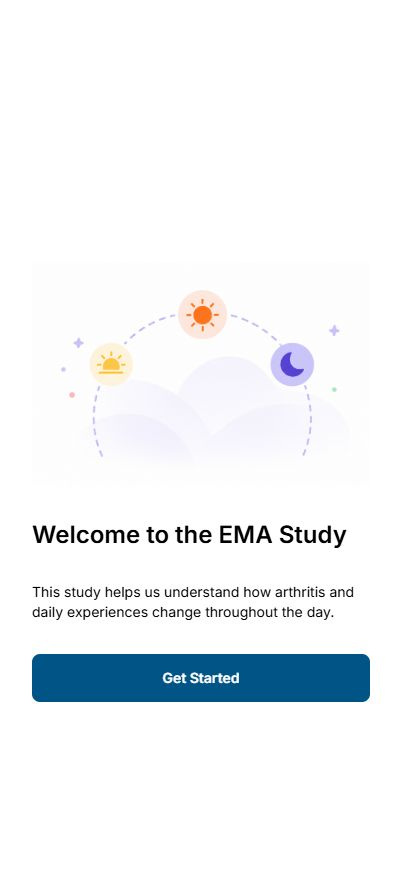
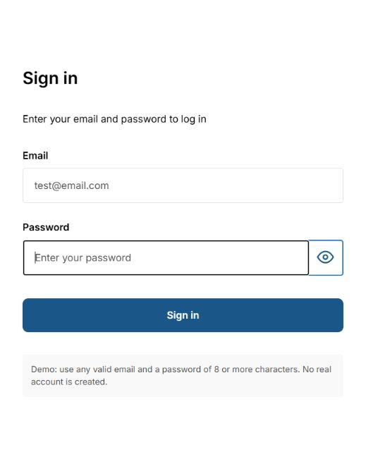
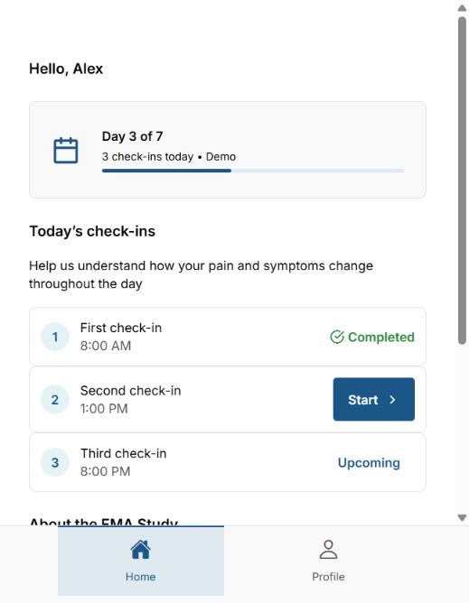
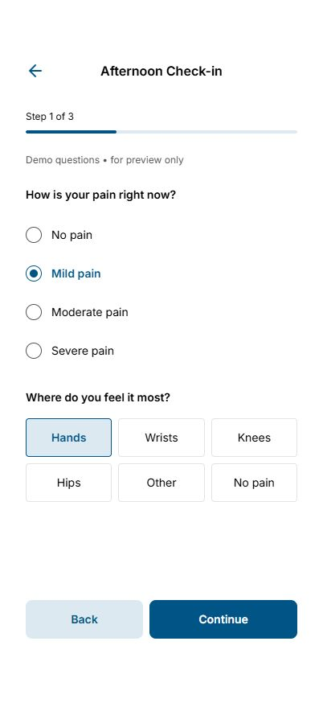
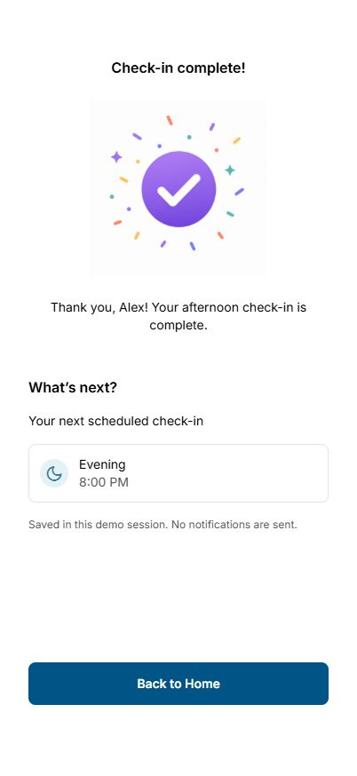
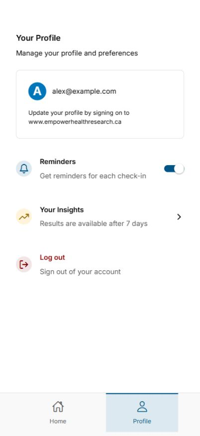
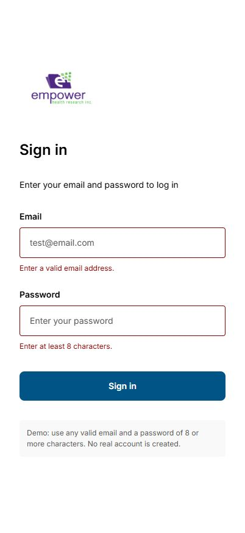
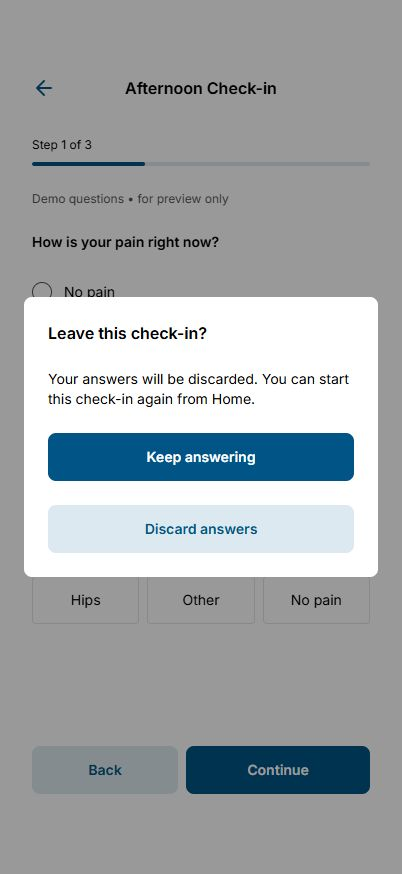
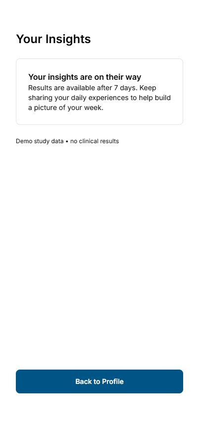

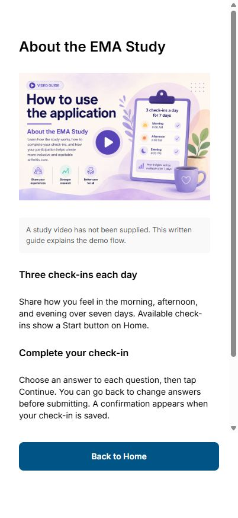
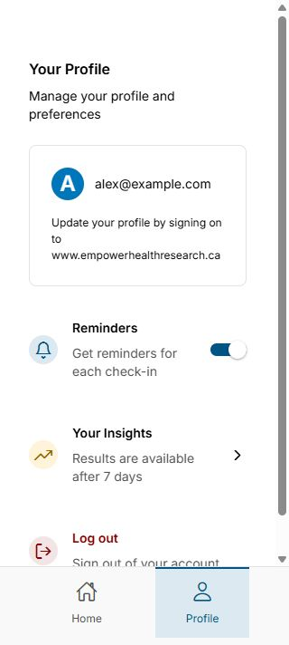

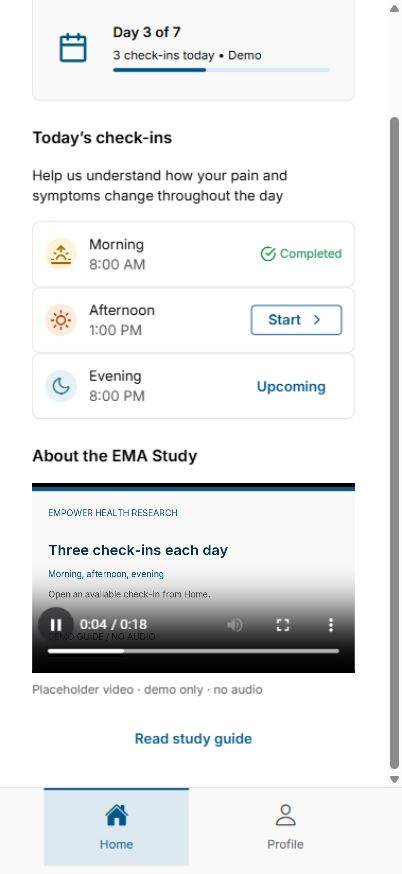

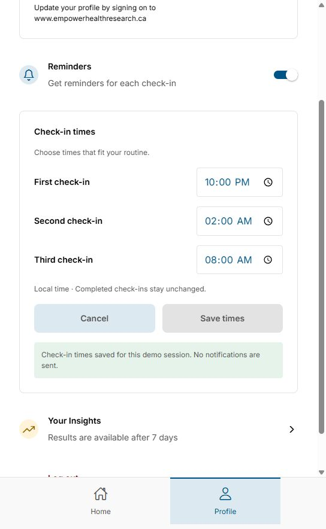
